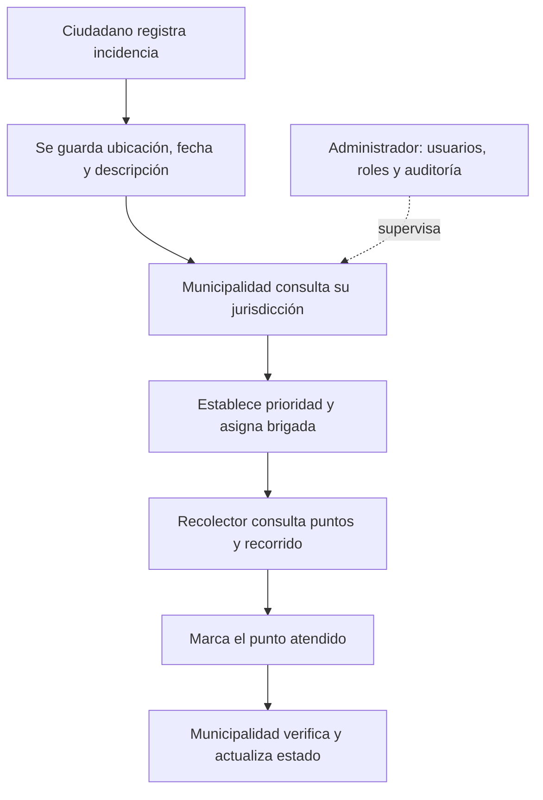

<div align="center">

# ♻️ CUSCO LIMPIO

### Plataforma de reportes ambientales, coordinación municipal y rutas de recolección

**Flutter · Dart · Android · Web (con limitaciones de compatibilidad)**


**Una plataforma para conectar a la ciudadanía con los equipos responsables de atender incidencias relacionadas con residuos sólidos.**

</div>

---

## 📌 1. Presentación

**Cusco Limpio** es una aplicación desarrollada en **Flutter y Dart** para registrar incidencias vinculadas con la acumulación de residuos, visualizar su ubicación y organizar su atención mediante perfiles diferenciados. Reúne en una sola solución el registro ciudadano, la gestión municipal, el trabajo de recolección y la administración de cuentas.

El proyecto parte de una situación concreta: un reporte ambiental resulta mucho más útil cuando incluye **qué sucede, dónde sucede, cuándo fue registrado y quién está a cargo de atenderlo**. Por ello, la aplicación utiliza formularios, ubicación geográfica, fotografías, fechas, estados de atención y recorridos visuales.

> **Alcance actual:** aplicación académica funcional con persistencia local y datos históricos sintéticos. No está conectada a los sistemas oficiales de las municipalidades ni representa una plataforma municipal en producción.

## 🎯 2. Objetivos

### Objetivo general

Desarrollar una aplicación multiplataforma que permita registrar, visualizar y gestionar incidencias relacionadas con residuos sólidos en sectores del Cusco, con funciones adaptadas a ciudadanos, municipalidades, recolectores y administradores del sistema.

### Objetivos específicos

- Facilitar el **registro de reportes** con descripción, clasificación, fotografía, fecha y ubicación.
- Presentar las incidencias en un **mapa interactivo** para apoyar su identificación y seguimiento.
- Diferenciar las **responsabilidades y los accesos** de los cuatro tipos de usuario.
- Organizar la atención mediante **prioridades, estados y asignación de brigadas**.
- Visualizar **rutas y paradas de recolección** junto con las incidencias pendientes asignadas.
- Registrar información histórica y acciones relevantes para su consulta posterior.
- Incorporar **pruebas automatizadas e integración continua** en el flujo de desarrollo.

## 👥 3. Perfiles y funciones

La aplicación trabaja con cuatro perfiles que **no realizan las mismas tareas**.

| Perfil | Propósito | Funciones principales |
|---|---|---|
| 👤 **Ciudadano** | Comunicar problemas ambientales | Crear reportes, adjuntar fotografías, indicar ubicación, consultar sus reportes y estados |
| 🛡️ **Administrador** | Administrar la plataforma | Crear cuentas de personal, buscar usuarios, modificar roles y adscripciones, habilitar o deshabilitar cuentas, eliminar cuentas con confirmación, consultar indicadores y bitácora |
| 🏛️ **Municipalidad** | Coordinar la atención dentro de su jurisdicción | Revisar incidencias del distrito asignado, definir prioridades, asignar brigadas, agregar observaciones, cambiar estados y verificar la atención |
| 🚛 **Recolector** | Ejecutar las tareas asignadas | Consultar incidencias de su brigada, revisar el recorrido, usar ubicación y marcar puntos atendidos |

### ¿Por qué son perfiles diferentes?

- El **Ciudadano** comunica el problema y consulta su seguimiento; no asigna personal.
- El **Administrador** gestiona quién puede acceder y con qué rol; no sustituye la coordinación operativa municipal.
- La **Municipalidad** distribuye el trabajo, registra decisiones y realiza el seguimiento operativo de las incidencias de su jurisdicción.
- El **Recolector** atiende tareas de campo; no administra usuarios ni determina permisos.

### Distritos incluidos en la configuración de ejemplo

**Cusco, Wanchaq, Santiago, San Sebastián y San Jerónimo.** La jurisdicción se asocia a cada cuenta municipal y se utiliza para filtrar sus incidencias. Estos registros no equivalen a credenciales o integraciones con municipalidades reales.

## 🔄 4. Flujo de atención de una incidencia



Los reportes pueden identificarse por sus estados de atención, incluyendo **Pendiente**, **En verificación**, **En atención** y **Solucionado**. Los cambios y la información disponible dependen del perfil con el que se inicia sesión.

## 🧩 5. Funcionalidades desarrolladas

### Registro y seguimiento de incidencias

- Formulario con descripción, dirección, distrito y tipo de residuo.
- Selección de ubicación mediante mapa o consulta del GPS del dispositivo.
- Incorporación de fotografía desde cámara o galería, sujeto a permisos y compatibilidad de plataforma.
- Generación y consulta de registros con fecha, estado, prioridad y brigada.
- Historial precargado en distintas fechas de **septiembre y octubre de 2026**, más los registros realizados por el usuario.

### Gestión de usuarios

- Inicio de sesión y creación de cuentas según permisos del perfil.
- Validación del **formato del correo** y control de correos duplicados.
- Creación de nuevos miembros desde el panel de Administración.
- Gestión de rol, brigada o jurisdicción, estado activo/inactivo y eliminación confirmada.
- Protección frente a determinadas operaciones sensibles, como intentar eliminar la cuenta administrativa propia.

**Aclaración:** validar un correo por formato no significa verificar que su propietario exista o controle esa dirección. No se envían correos de confirmación.

### Mapas y recorridos

- Visualización del mapa mediante **flutter_map** y mosaicos de **OpenStreetMap**.
- Marcadores de incidencias y consulta de coordenadas.
- Tres recorridos ilustrativos, asociados a brigadas, con múltiples paradas y horarios de referencia.
- Incorporación de reportes pendientes asignados a la polilínea de su brigada para que sus marcadores aparezcan sobre el recorrido representado.

**Alcance del mapa:** las rutas son trazados aproximados entre coordenadas; no se calculan sobre la red de calles ni incorporan tráfico, sentidos de circulación o navegación vehicular. Para ello sería necesario integrar un motor de enrutamiento vial.

### Supervisión y trazabilidad

- Indicadores de reportes, estado de atención y actividad según perfil.
- Observaciones y prioridades municipales.
- Bitácora local de determinados cambios y acciones sobre reportes.
- Pantallas de inicio diferenciadas: **azul institucional** (Administrador), **turquesa** (Municipalidad), **ámbar** (Recolector) y **verde** (Ciudadano).

## 🏗️ 6. Arquitectura y organización

La aplicación emplea una arquitectura Flutter local, basada en interfaces de usuario, modelos y clases responsables de la gestión y persistencia de datos.

```text
cusco_limpio_rutas/
├── lib/
│   ├── main.dart             # Pantallas, reportes, rutas, gestión y estado
│   └── auth.dart             # Sesiones, cuentas, roles y validaciones
├── assets/
│   └── images/               # Recursos gráficos
├── test/
│   ├── widget_test.dart      # Comprobaciones de reportes y recorridos
│   ├── role_permissions_test.dart
│   └── admin_users_test.dart
├── .github/
│   └── workflows/
│       └── flutter_ci.yml    # Análisis y pruebas en GitHub Actions
├── pubspec.yaml              # Dependencias y recursos
├── android/                  # Generada por el proyecto Flutter completo
├── web/                      # Generada por el proyecto Flutter completo
└── README.md
```

### Persistencia de información

Se utiliza **SharedPreferences** para conservar datos localmente en el entorno de la aplicación. Este almacenamiento permite demostrar persistencia entre sesiones, pero **no sincroniza cuentas o reportes entre teléfonos**, ni reemplaza una base de datos central con control de acceso en servidor.

## 🛠️ 7. Tecnologías y dependencias

| Tecnología | Función en el proyecto |
|---|---|
| **Flutter / Dart** | Interfaz, lógica y ejecución multiplataforma |
| **flutter_map** | Representación interactiva de mapas |
| **latlong2** | Coordenadas y puntos geográficos |
| **OpenStreetMap** | Provisión de mosaicos cartográficos a través de internet |
| **geolocator** | Consulta de ubicación y permisos de geolocalización |
| **image_picker** | Selección o captura de fotografías |
| **shared_preferences** | Persistencia local de datos |
| **crypto** | Operaciones criptográficas utilizadas en el manejo local de credenciales |
| **path_provider** | Acceso a directorios locales compatibles |
| **flutter_test** | Pruebas automatizadas |
| **GitHub Actions** | Ejecución de verificaciones al subir cambios |

### ¿Se consumen APIs?

**Sí**, se accede al servicio externo de mosaicos de OpenStreetMap y a las interfaces del dispositivo para ubicación y fotografías. **No** existe todavía una API REST propia de la aplicación ni un servicio de rutas por carretera. El consumo de mapas y las APIs del dispositivo no deben confundirse con disponer de un backend municipal.

## 🧪 8. Pruebas y calidad

El repositorio incluye archivos de pruebas que comprueban, entre otros aspectos:

- La estructura y serialización de reportes.
- La existencia de los cuatro roles.
- La relación entre las incidencias asignadas y el recorrido de una brigada.
- La creación de cuentas municipales con jurisdicción.
- El rechazo de correos duplicados y restricciones de administración.

Ejecutar desde la raíz del proyecto:

```bash
flutter pub get
flutter analyze
flutter test
flutter test --coverage
```

El informe de cobertura se genera en `coverage/lcov.info` si la ejecución se completa correctamente.

### Integración continua con GitHub Actions

Existe un workflow en `.github/workflows/flutter_ci.yml` que se activa en **push** y **pull request** sobre `main`. Prepara Flutter, descarga dependencias, ejecuta análisis estático y pruebas. La comprobación de formato está configurada como no bloqueante.

**Para revisar el resultado real:** abrir la pestaña **Actions** del repositorio y consultar el estado de cada ejecución. La existencia del workflow no implica que todas las ejecuciones hayan sido exitosas.

## 🚀 9. Instalación y ejecución

### Requisitos

- Flutter SDK instalado y configurado.
- Android Studio o Visual Studio Code con soporte Flutter/Dart.
- Android SDK para ejecutar en un teléfono o emulador Android.
- Chrome para pruebas web.
- Conexión a internet para cargar los mosaicos del mapa.

### Desde el repositorio

```bash
git clone https://github.com/JuanGabriel03/Cusco_Limpio_Flutter.git
cd Cusco_Limpio_Flutter
flutter pub get
flutter doctor
flutter run
```

Para ejecutar específicamente en el navegador:

```bash
flutter run -d chrome
```

Para listar dispositivos conectados:

```bash
flutter devices
```

### Nota sobre plataformas

El proyecto se ha trabajado en Android Studio y se ha probado manualmente en Chrome durante su desarrollo. **Algunas operaciones con archivos e imágenes pueden requerir ajustes específicos para Web**, especialmente aquellas basadas en `dart:io` o archivos locales. Las funcionalidades de cámara, GPS y permisos deben validarse también en un dispositivo Android real.

## 🧭 10. Guía breve de demostración

| Orden | Perfil | Qué mostrar al docente |
|---|---|---|
| 1 | Ciudadano | Crear incidencia, escoger ubicación, adjuntar fotografía y consultar su estado |
| 2 | Municipalidad | Filtrar por jurisdicción, priorizar y asignar la incidencia a una brigada |
| 3 | Recolector | Ver el punto asignado en el mapa y registrar su atención |
| 4 | Municipalidad | Verificar la atención y actualizar el estado |
| 5 | Administrador | Crear un miembro, cambiar su rol o jurisdicción, desactivar una cuenta y consultar indicadores/bitácora |
| 6 | Desarrollo | Ejecutar `flutter test` y mostrar el historial de GitHub Actions |

> Las cuentas de ejemplo y su clave inicial se documentan en `LEEME_PRIMERO.md` para pruebas locales. **No deben utilizarse como cuentas reales de producción.**

## 🔒 11. Seguridad, privacidad y límites actuales

- La autenticación y la autorización se implementan de forma **local**; no existe validación centralizada mediante un servidor.
- No hay sincronización entre dispositivos ni administración municipal en tiempo real.
- Los distritos, usuarios, datos históricos y brigadas precargados son **información de ejemplo** para demostrar procesos.
- El proyecto no envía emails de verificación ni notificaciones push.
- Los recorridos no ofrecen navegación real sobre calles ni optimización logística.
- Antes de un uso real se necesitarían backend, base de datos, control de acceso en servidor, gestión segura de credenciales, políticas de privacidad, respaldo y protección de fotografías y ubicaciones.

Estos límites están documentados para distinguir con claridad **lo que ya funciona** de las capacidades que requieren desarrollo adicional.

## 📈 12. Próximas mejoras propuestas

1. Integrar un backend y una base de datos compartida, con autenticación y autorización seguras.
2. Implementar verificación de correo y recuperación de contraseñas.
3. Incorporar un motor de rutas viales (por ejemplo, OSRM) y cálculo de recorrido por calles.
4. Añadir evidencia fotográfica de atención, notificaciones y seguimiento sincronizado.
5. Ampliar pruebas de widgets e integración y medir cobertura de forma continua.
6. Preparar despliegue web compatible y paquetes Android firmados para distribución.

## 📚 13. Referencias técnicas e institucionales

- [Documentación oficial de Flutter](https://docs.flutter.dev/)
- [Documentación oficial de Dart](https://dart.dev/guides)
- [flutter_map](https://docs.fleaflet.dev/)
- [OpenStreetMap](https://www.openstreetmap.org/)
- [Geolocator](https://pub.dev/packages/geolocator)
- [GitHub Actions](https://docs.github.com/en/actions)
- [Ministerio del Ambiente del Perú — MINAM](https://www.gob.pe/minam)

---

<div align="center">

**CUSCO LIMPIO**  
*Tecnología para registrar, organizar y dar seguimiento a las incidencias ambientales.*

**Proyecto académico de desarrollo de software — 2026**

</div>
